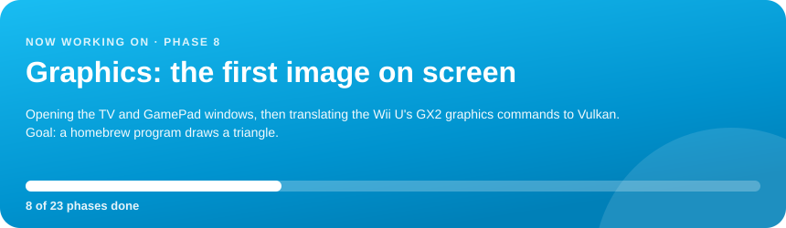
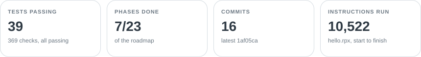
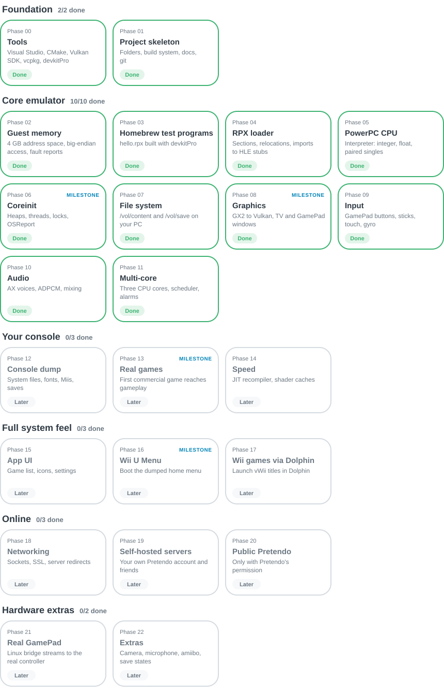

<!-- Generated by tools/build-readme.js from the progress snapshot. Edit the snapshot, not this file. -->

  <a href="https://thatrandumb1.github.io/wiiue/">
  <picture>
    <source media="(prefers-color-scheme: dark)" srcset="assets/logo-dark.svg">
    <source media="(prefers-color-scheme: light)" srcset="assets/logo-light.svg">
    
  </picture>
  </a>

<b>Wii U emulator, built from scratch</b>

  
  
  
  

  

  <picture>
    <source media="(prefers-color-scheme: dark)" srcset="assets/stats-dark.svg">
    <source media="(prefers-color-scheme: light)" srcset="assets/stats-light.svg">
    
  </picture>

## Roadmap

  <picture>
    <source media="(prefers-color-scheme: dark)" srcset="assets/roadmap-dark.svg">
    <source media="(prefers-color-scheme: light)" srcset="assets/roadmap-light.svg">
    
  </picture>

## Recent activity

- `Oct 14, 5:25 PM` · **P6** · Progress page opened to the public
- `Oct 14, 5:15 PM` · **P6** · Live progress page published · `278bc00`
- `Oct 14, 5:10 PM` · **P6** · Started coreinit, the Wii U's core system library
- `Oct 14, 5:07 PM` · **P5** · CPU interpreter runs: 677 instructions of real startup code before the first missing system call · `1b9757a`
- `Oct 14, 4:55 PM` · **P4** · RPX loader: hello.rpx loads, matches the compiler's output byte for byte · `cf9af50`
- `Oct 14, 4:47 PM` · **P2** · Guest memory working: 4 GB address space, big-endian reads and writes · `47ff654`
- `Oct 14, 4:44 PM` · **P0** · All tools installed after fixing a stuck devkitPro install; hello.rpx builds · `bb71fe2`
- `Oct 14, 4:08 PM` · **P1** · Project created: build system, docs, folder for your console dump · `7417865`

---

Last updated Oct 14, 2026, 5:25 PM PDT. Full live view: <a href="https://thatrandumb1.github.io/wiiue/">https://thatrandumb1.github.io/wiiue/</a> 
Fan project page. Not affiliated with or endorsed by Nintendo.
