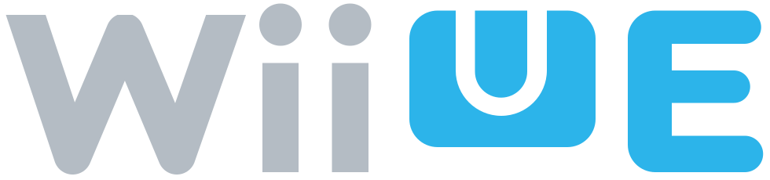
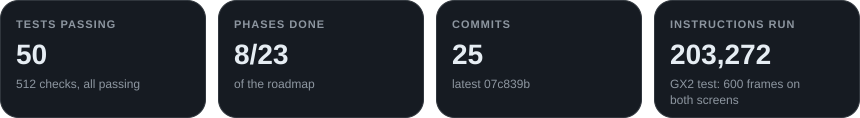
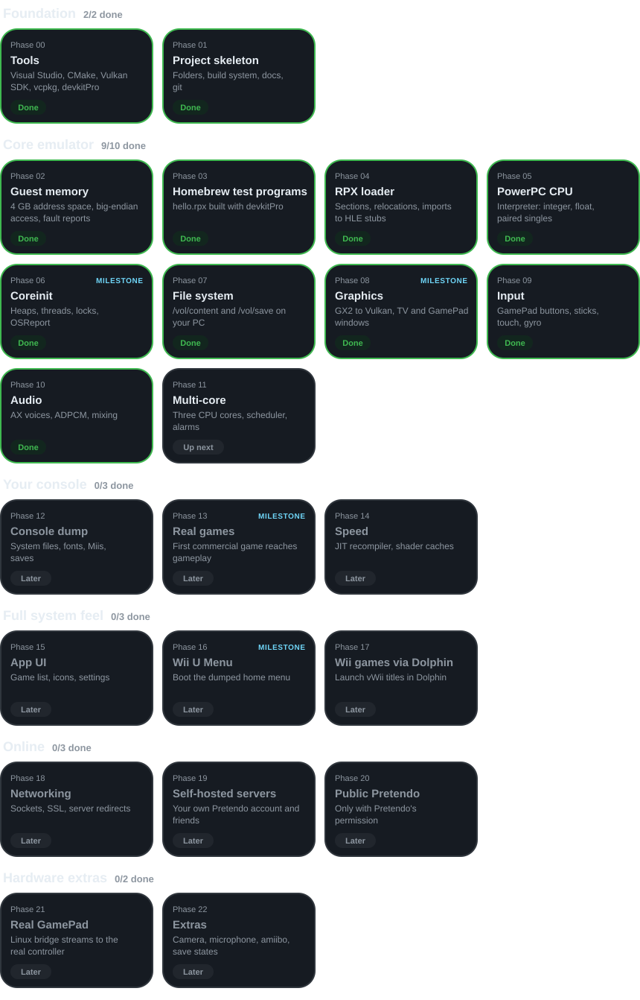

<!-- Generated by tools/build-readme.js from the progress snapshot. Edit the snapshot, not this file. -->

  
  

<b>Wii U emulator, built from scratch</b>

  
  
  
  

  

  
  

## Roadmap

  
  

## Recent activity

- `Oct 14, 8:44 PM` · **P8** · First real 3D: depth buffers and back-face culling work, and a test program spins two cubes in perspective · `901aadc`
- `Oct 14, 8:13 PM` · **P11** · Multi-core done: threads run on all three cores with priorities, locks, events, queues, sleeps and alarms; the threads test passes 9/9 · `14bae43`
- `Oct 14, 7:35 PM` · **P10** · Audio done: the AX mixer plays PCM and ADPCM voices with pitch and volume on your speakers; a test program plays a C-E-G-C tune · `e8c71ee`
- `Oct 14, 7:03 PM` · **P9** · Input done: GamePad buttons, sticks, touch screen and motion work from the keyboard, mouse or a game controller · `4b79a22`
- `Oct 14, 6:47 PM` · **P8** · Graphics done: Wii U shaders are translated to Vulkan and a spinning 3D triangle draws on both screens on the graphics card · `774489c`
- `Oct 14, 6:25 PM` · **P8** · GX2 graphics library running: a program set up the standard way clears both screens to cycling colors and quits cleanly when the window closes · `07c839b`
- `Oct 14, 6:15 PM` · **P8** · Milestone: first image on screen. TV and GamePad windows open, and a test program draws text, colors and a moving square at 60 fps · `ec18455`
- `Oct 14, 5:59 PM` · **P8** · Started graphics

## History of the Wii U

The console this project brings back.

| When | What happened |
|---|---|
| **Jun 2011** | Revealed at E3 as Nintendo's successor to the Wii, built around a tablet-style controller with its own screen: the Wii U GamePad. |
| **Nov 2012** | Launches in North America on November 18, then Europe and Australia (Nov 30) and Japan (Dec 8), in an 8 GB Basic and a 32 GB Deluxe model. Launch games include New Super Mario Bros. U, Nintendo Land and ZombiU, and Miiverse, a built-in social network, goes live. |
| **2013** | Big first-party year: Super Mario 3D World, Pikmin 3 and The Legend of Zelda: The Wind Waker HD. |
| **2014** | Mario Kart 8 and Super Smash Bros. for Wii U arrive and become the console's best sellers. |
| **2015** | Splatoon and Super Mario Maker launch. Cemu, the first Wii U emulator, appears that October. |
| **Mar 2017** | The Legend of Zelda: Breath of the Wild launches on Wii U and on its replacement, the Nintendo Switch. Production has already ended; lifetime sales finish at 13.56 million. Many Wii U games later return on Switch. |
| **Nov 2017** | Miiverse shuts down. |
| **Mar 2023** | The Wii U eShop closes to new purchases. |
| **Apr 2024** | Nintendo Network goes offline, ending official online play. The fan-run Pretendo Network keeps some of it alive, and emulators keep the library playable. |

### Inside the console

| Part | Details |
|---|---|
| **CPU** | IBM "Espresso": 3 PowerPC cores at 1.24 GHz, with paired-single floating point |
| **GPU** | AMD "Latte", about 550 MHz, with 32 MB of fast on-chip memory (MEM1) |
| **Memory** | 2 GB: 1 GB for games, 1 GB for the system |
| **GamePad** | 6.2-inch 854×480 touchscreen streamed over 5 GHz Wi-Fi, plus gyro, camera, microphone and NFC |
| **Storage** | 8 or 32 GB built in, plus USB drives |
| **Wii mode** | Plays Wii discs and uses Wii Remotes through a built-in Wii system (vWii) |

---

Last updated Oct 14, 2026, 8:45 PM PDT. Full live view: <a href="https://thatrandumb1.github.io/wiiue/">https://thatrandumb1.github.io/wiiue/</a> 
Fan project page. Not affiliated with or endorsed by Nintendo.
